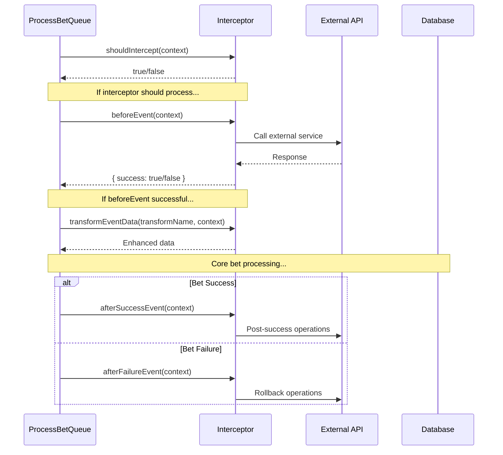

# Event Interceptor System Documentation

## Overview

The Event Interceptor System provides a clean, extensible way to handle cross-cutting concerns in the SC Game Base architecture. It follows the established patterns of the game base framework and allows for modular, reusable logic that can be applied across different bet processing workflows.

## Architecture Principles

### Design Philosophy

- **Event-driven**: Intercepts events during bet processing lifecycle
- **Modular**: Each interceptor handles a single concern (promotion, analytics, etc.)
- **Non-intrusive**: Doesn't modify core bet processing logic
- **Extensible**: Easy to add new interceptors without changing existing code
- **Follows Game Base Patterns**: Uses established DI, naming, and architectural conventions

### Key Components

- **BaseEventInterceptor**: Abstract base class defining interceptor interface
- **Concrete Interceptors**: Specific implementations (PromotionBetInterceptor, etc.)
- **ProcessBetQueue**: Orchestrates interceptor execution during bet processing
- **Container Registry**: Manages interceptor registration and dependency injection

## Event Interceptor Lifecycle



## Creating a New Event Interceptor

### Step 1: Create Interceptor Class

```javascript
// src/core/event-interceptors/my-custom-interceptor.js
import BaseEventInterceptor from "./base-event-interceptor.js";

export default class MyCustomInterceptor extends BaseEventInterceptor {
  /**
   * @param {Object} dependencies
   * @param {Object} dependencies.logService - Logging service
   * @param {Object} dependencies.definition - Game definition
   * @param {Object} dependencies.myApiClient - Custom API client
   */
  constructor({ logService, definition, myApiClient }) {
    super({ logService, definition });
    this.myApiClient = myApiClient;
  }

  /**
   * Determine if this interceptor should process the bet
   * @param {Object} context - Event context
   * @returns {boolean} Whether this interceptor should process
   */
  shouldIntercept(context) {
    const { payload } = context;

    // Check if this interceptor should handle this bet
    if (!payload || !payload.myCustomFlag) {
      return false;
    }

    // Check if required dependencies are available
    if (!this.myApiClient) {
      return false;
    }

    return true;
  }

  /**
   * Process before bet placement
   * @param {Object} context - Event context
   * @param {Object} context.player - Player object
   * @param {Object} context.payload - Bet payload
   * @returns {Promise<Object>} Result with success status
   */
  async beforeEvent(context) {
    const { player, payload } = context;

    try {
      // Pre-bet processing logic
      const result = await this.myApiClient.preProcessBet({
        playerId: player.session.playerId,
        amount: payload.amount,
      });

      if (!result.success) {
        this.logService.logError(`Pre-processing failed for player ${player.profile.name}`);
        return { success: false };
      }

      return { success: true };
    } catch (error) {
      this.logService.logError(`Error in pre-processing for player ${player.profile.name}:`, error);
      return { success: false };
    }
  }

  /**
   * Process after successful bet placement
   * @param {Object} context - Event context
   * @returns {Promise<void>}
   */
  async afterSuccessEvent(context) {
    const { player, bet } = context;

    try {
      await this.myApiClient.postProcessBet({
        playerId: player.session.playerId,
        betId: bet.id,
      });
    } catch (error) {
      this.logService.logError(`Post-processing failed for player ${player.profile.name}:`, error);
    }
  }

  /**
   * Process after failed bet placement
   * @param {Object} context - Event context
   * @returns {Promise<void>}
   */
  async afterFailureEvent(context) {
    const { player, bet } = context;

    try {
      await this.myApiClient.rollbackBet({
        playerId: player.session.playerId,
        betData: bet,
      });
    } catch (error) {
      this.logService.logError(`Rollback failed for player ${player.profile.name}:`, error);
    }
  }

  /**
   * Transform event data with custom metadata
   * @param {string} transformName - Name of the transformation
   * @param {Object} context - Event context
   * @returns {Object} Transformed data
   */
  transformEventData(transformName, context) {
    if (transformName === "enhanceBetInfo" && this.shouldEnhance(context)) {
      const enhanced = { ...context.betInfo };
      enhanced.metadata.customFlag = true;
      return enhanced;
    }
    // Default returns first context value
    return super.transformEventData(transformName, context);
  }
}
```

### Step 2: Register Dependencies

```javascript
// In your game service's container-registry.js
import MyCustomInterceptor from "./event-interceptors/my-custom-interceptor.js";

export default class GameContainerRegistry extends ContainerRegistry {
  register(appConfigs, definition, gameData) {
    // Call parent registration first
    super.register(appConfigs, definition, gameData);

    // Register your custom dependencies
    this.registerCustomDependencies();

    return this.container;
  }

  registerCustomDependencies() {
    this.container.register({
      myApiClient: asClass(MyApiClient).singleton(),
    });
  }

  registerInterceptors() {
    // Call parent interceptor registration
    super.registerInterceptors();

    // Register your custom interceptor
    this.container.register({
      myCustomInterceptor: asClass(MyCustomInterceptor).singleton(),
    });
  }

  registerInterceptorArrays() {
    this.container.register({
      betEventInterceptors: asFunction((container) => [
        container.promotionBetInterceptor,
        container.myCustomInterceptor, // Add your interceptor
      ]).singleton(),
    });
  }
}
```

### Step 3: Export from Index

```javascript
// src/core/event-interceptors/index.js
import BaseEventInterceptor from "./base-event-interceptor.js";
import PromotionBetInterceptor from "./promotion-bet-interceptor.js";
import MyCustomInterceptor from "./my-custom-interceptor.js";

export { BaseEventInterceptor, PromotionBetInterceptor, MyCustomInterceptor };
```

## Event Context Reference

### shouldIntercept Context

```javascript
{
    payload: {
        betChoice: "red",
        amount: 100,
        usePromotion: true,
        // ... other bet payload properties
    }
}
```

### beforeEvent Context

```javascript
{
    player: {
        UID: "player123",
        profile: { name: "PlayerName", minBet: 1, maxBet: 10000 },
        session: { operatorId: "OP1", playerId: "P123", currencyCode: "USD" },
        promotion: { promotionId: "promo123", bonusItemCount: 5 }
    },
    payload: {
        betChoice: "red",
        amount: 0,
        usePromotion: true,
        promotionId: "promo123"
    }
}
```

### afterSuccessEvent Context

```javascript
{
    player: { /* same as beforeEvent */ },
    bet: {
        betChoice: "red",
        amount: 0,
        roundId: 12345,
        usePromotion: true,
        promotionId: "promo123"
    },
    balance: { red: 1000, minBet: 1, maxBet: 10000 },
    betTime: Date
}
```

### afterFailureEvent Context

```javascript
{
    player: { /* same as beforeEvent */ },
    bet: { /* same as afterSuccessEvent */ },
    notice: { errorCode: 1001, message: "Bet failed" }
}
```

### Transform Context

```javascript
// For enhanceBetInfo
{
    betInfo: {
        amount: 0,
        gameId: 1,
        gameRoundId: 12345,
        choiceId: 1,
        metadata: { mode: "1" }
    },
    payload: { /* bet payload */ }
}

// For enhanceBetRecord
{
    betRecord: {
        uid: "player123",
        name: "PlayerName",
        time: Date,
        odds: { red: 2.0 },
        roundId: 12345
    },
    bet: { /* bet data */ }
}

// For enhanceBetLog
{
    betLog: {
        uid: "player123",
        name: "PlayerName",
        time: Date,
        choice: "red",
        amount: 0,
        roundId: 12345
    },
    bet: { /* bet data */ }
}
```

## Best Practices

### 1. Single Responsibility

Each interceptor should handle only one cross-cutting concern:

- ✅ PromotionBetInterceptor: Handles promotion logic only
- ✅ AnalyticsBetInterceptor: Handles analytics tracking only
- ❌ PromotionAnalyticsInterceptor: Handles multiple concerns

### 2. Fail-Safe Design

```javascript
shouldIntercept(context) {
    // Always validate required data
    if (!payload || !payload.requiredField) {
        return false;
    }

    // Always check dependency availability
    if (!this.requiredApiClient) {
        return false;
    }

    return true;
}
```

### 3. Error Handling

```javascript
async beforeEvent(context) {
    try {
        // Main logic here
        return { success: true };
    } catch (error) {
        // Always log errors with context
        this.logService.logError(`Operation failed for player ${player.profile.name}:`, error);
        return { success: false };
    }
}
```

### 4. Clean Transformations

```javascript
transformEventData(transformName, context) {
    if (transformName === "enhanceBetInfo" && this.shouldEnhance(context)) {
        const enhanced = { ...context.betInfo };
        enhanced.metadata.customFlag = true;
        return enhanced;
    }
    // Default returns first context value
    return super.transformEventData(transformName, context);
}
```

### 5. Dependency Injection

```javascript
// Always use constructor injection
constructor({ logService, definition, requiredApiClient }) {
    super({ logService, definition });
    this.requiredApiClient = requiredApiClient;
}

// Always validate in shouldIntercept
shouldIntercept(context) {
    if (!this.requiredApiClient) {
        return false;
    }
    // ... rest of logic
}
```

## Testing Event Interceptors

### Unit Testing Example

```javascript
// src/core/event-interceptors/__tests__/my-custom-interceptor.test.js
import MyCustomInterceptor from "../my-custom-interceptor.js";

describe("MyCustomInterceptor", () => {
  let interceptor;
  let mockDependencies;
  let context;

  beforeEach(() => {
    mockDependencies = {
      logService: { logError: jest.fn() },
      definition: { id: 1 },
      myApiClient: { preProcessBet: jest.fn() },
    };

    interceptor = new MyCustomInterceptor(mockDependencies);

    context = {
      player: { profile: { name: "TestPlayer" } },
      payload: { myCustomFlag: true, amount: 100 },
    };
  });

  describe("shouldIntercept", () => {
    it("should return true for valid custom bets", () => {
      expect(interceptor.shouldIntercept(context)).toBe(true);
    });

    it("should return false when custom flag is missing", () => {
      context.payload.myCustomFlag = false;
      expect(interceptor.shouldIntercept(context)).toBe(false);
    });

    it("should return false when API client is not available", () => {
      interceptor.myApiClient = null;
      expect(interceptor.shouldIntercept(context)).toBe(false);
    });
  });

  describe("beforeEvent", () => {
    it("should return success when API call succeeds", async () => {
      mockDependencies.myApiClient.preProcessBet.mockResolvedValue({ success: true });

      const result = await interceptor.beforeEvent(context);

      expect(result.success).toBe(true);
    });

    it("should return failure when API call fails", async () => {
      mockDependencies.myApiClient.preProcessBet.mockResolvedValue({ success: false });

      const result = await interceptor.beforeEvent(context);

      expect(result.success).toBe(false);
    });
  });
});
```

### Integration Testing

```javascript
// Integration test with ProcessBetQueue
describe("MyCustomInterceptor Integration", () => {
  it("should process custom bets through complete flow", async () => {
    // Setup ProcessBetQueue with interceptor
    const processBetQueue = new ProcessBetQueue({
      // ... dependencies
      betEventInterceptors: [myCustomInterceptor],
    });

    // Mock API responses
    mockApiClient.preProcessBet.mockResolvedValue({ success: true });
    mockPlaceBet.mockResolvedValue({ isOk: true, response: {} });

    // Execute bet processing
    await processBetQueue.proceedBet(player, customPayload);

    // Verify interceptor was called
    expect(mockApiClient.preProcessBet).toHaveBeenCalled();
  });
});
```

## Common Use Cases

### 1. Analytics Tracking

```javascript
export default class AnalyticsBetInterceptor extends BaseEventInterceptor {
  shouldIntercept(context) {
    return this.analyticsClient && context.payload;
  }

  async afterSuccessEvent(context) {
    await this.analyticsClient.trackBetSuccess({
      playerId: context.player.session.playerId,
      gameId: this.definition.id,
      amount: context.bet.amount,
    });
  }
}
```

### 2. Risk Management

```javascript
export default class RiskManagementInterceptor extends BaseEventInterceptor {
  async beforeEvent(context) {
    const riskScore = await this.riskClient.calculateRisk({
      playerId: context.player.session.playerId,
      amount: context.payload.amount,
    });

    if (riskScore > this.riskThreshold) {
      return { success: false };
    }

    return { success: true };
  }
}
```

### 3. Bonus System

```javascript
export default class BonusBetInterceptor extends BaseEventInterceptor {
  shouldIntercept(context) {
    return context.payload?.useBonusFunds === true;
  }

  async beforeEvent(context) {
    const bonusResult = await this.bonusClient.deductBonus({
      playerId: context.player.session.playerId,
      amount: context.payload.amount,
    });

    return { success: bonusResult.success };
  }
}
```

## Performance Considerations

### 1. Lightweight shouldIntercept

```javascript
// ✅ Good - Fast checks first
shouldIntercept(context) {
    if (!context.payload?.specialFlag) return false;
    if (!this.apiClient) return false;
    return true;
}

// ❌ Avoid - Heavy operations in shouldIntercept
shouldIntercept(context) {
    const heavyCalculation = this.performComplexLogic(context);
    return heavyCalculation.shouldProcess;
}
```

### 2. Async Error Handling

```javascript
// ✅ Good - Non-blocking error handling
async afterSuccessEvent(context) {
    try {
        await this.apiClient.postProcess(context);
    } catch (error) {
        // Log but don't throw - don't block bet completion
        this.logService.logError("Post-processing failed:", error);
    }
}
```

### 3. Minimal Data Transformation

```javascript
// ✅ Good - Only transform when necessary
transformEventData(transformName, context) {
    if (transformName === "enhanceBetInfo" && this.shouldEnhance(context)) {
        const enhanced = { ...context.betInfo };
        enhanced.metadata.customFlag = true;
        return enhanced;
    }
    // Default returns first context value
    return super.transformEventData(transformName, context);
}
```

## Troubleshooting

### Common Issues

1. **Interceptor Not Being Called**

   - Check `shouldIntercept` return value
   - Verify interceptor is registered in container
   - Ensure interceptor is added to `betEventInterceptors` array

2. **beforeEvent Blocking Bet Processing**

   - Ensure `beforeEvent` returns `{ success: true }` for valid bets
   - Check for unhandled exceptions
   - Verify API availability checks

3. **Data Not Being Enhanced**
   - Check `transformEventData` method implementation
   - Verify transform name matches expected values
   - Ensure context contains expected data

### Debug Logging

```javascript
// Add debug logging to track interceptor execution
shouldIntercept(context) {
    const result = /* your logic */;
    this.logService.logDebug(`${this.name} shouldIntercept: ${result}`, context);
    return result;
}
```

## Conclusion

The Event Interceptor System provides a powerful, clean way to extend bet processing functionality while maintaining the architectural integrity of the SC Game Base framework. By following the established patterns and best practices outlined in this documentation, you can create maintainable, testable, and performant interceptors that enhance your game's capabilities without compromising core functionality.

Remember to always:

- Follow the single responsibility principle
- Use proper error handling
- Validate dependencies in `shouldIntercept`
- Write comprehensive tests
- Follow game base naming and architectural conventions
