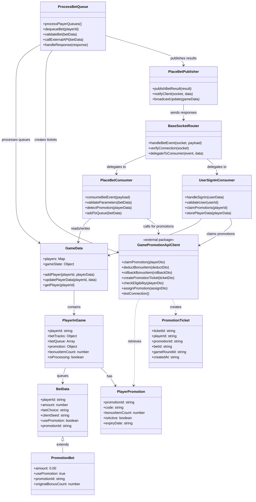

# Place Bet System - Class Diagram (Updated with Promotion)

## Overview

This class diagram shows the relationships between all components in the place bet system, including the promotion functionality and promotion API integration using the official `@sc/game-promotion-api-client` package.

## Class Diagram

## Key Components

### Core Flow Components

- `BaseSocketRouter` handles WebSocket events and routes to appropriate consumers
- `PlaceBetConsumer` processes bet requests and manages validation
- `ProcessBetQueue` asynchronously processes bet queues with external API calls
- `PlaceBetPublisher` handles real-time client notifications

### Official Promotion Integration

- `GamePromotionApiClient` is the official Pentagon package for promotion operations
- Handles all promotion-related API calls including claiming, deducting, and ticket creation
- Provides standardized interface for promotion management

### Data Management

- `GameData` manages all in-memory game state and player data
- `PlayerInGame` represents individual player state including promotions
- `BetData` represents individual bet information
- `PromotionBet` extends BetData for promotion specific functionality

### Promotion System

- `PlayerPromotion` represents promotion data stored in PlayerInGame
- `PromotionTicket` represents audit trail tickets for promotion usage
- Integration with official Pentagon promotion APIs for all operations

## Promotion Integration Points

1. **Sign-In**: `UserSignInConsumer` calls `GamePromotionApiClient.claimPromotion()`
2. **Detection**: `PlaceBetConsumer` detects promotions from PlayerInGame promotion data
3. **Deduction**: `PlaceBetConsumer` calls `GamePromotionApiClient.deductBonusItem()`
4. **Processing**: `ProcessBetQueue` creates tickets via `GamePromotionApiClient.createPromotionTicket()`
5. **Rollback**: Error scenarios call `GamePromotionApiClient.rollbackBonusItem()`

## API Integration

The system now uses the official `@sc/game-promotion-api-client` package directly:

- **Standardized**: Uses Pentagon's official API client
- **Maintained**: Officially supported and maintained by Pentagon
- **Consistent**: Follows Pentagon's standard patterns and conventions
- **Reliable**: Production-tested and validated by Pentagon team

This integration ensures compatibility with Pentagon's promotion infrastructure while maintaining clean separation of concerns in the game system architecture.
