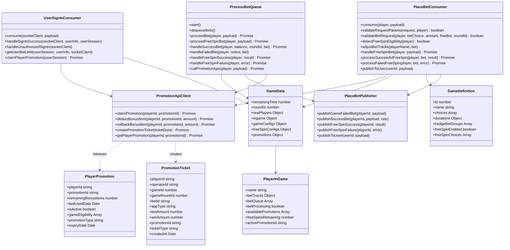

# Place Bet System - Class Diagram (Updated with Free Spin)

## Key Relationships:

### 1. **Free Spin Integration**

- `UserSignInConsumer` claims promotions during sign-in and stores data in `PlayerInGame`
- `PlaceBetConsumer` automatically detects free spin eligibility from player data
- `ProcessBetQueue` handles both regular and free spin bet processing with API integration
- Simplified architecture with promotion data pre-loaded at sign-in

### 2. **Simplified Architecture**

- Removed base classes (`BaseSocketRouter`, `BaseEventPublisher`) for cleaner design
- `PromotionApiClient` handles all promotion-related API calls
- `PlayerPromotion` and `PromotionTicket` are data models returned from APIs
- Direct relationships between core business logic components

### 3. **Data Management**

- `GameData` includes free spin configurations
- `PlayerInGame` tracks player state including available promotions and free spins
- `PromotionTicket` (via API) tracks all free spin metadata and status

### 4. **Validation & Processing**

- `PlaceBetConsumer` handles free spin validation through Promotion APIs
- Bonus item management through Promotion APIs
- Rollback mechanisms via API calls for failed free spin attempts

### 5. **Event Publishing**

- `PlaceBetPublisher` handles all client notifications directly
- Free spin specific notification methods included
- Separate success/failure handling for free spin results

### 6. **Game Configuration**

- `GameDefinition` includes free spin enablement and eligible choices
- `GameData` maintains free spin specific configurations

## Free Spin Flow Integration:

### **Sign-In Processing:**

1. `UserSignInConsumer` calls `player-promotion/claim-promotion` API during sign-in
2. Store promotion data in `PlayerInGame` for quick access

### **Bet Processing:**

1. `PlaceBetConsumer` detects free spin eligibility from `PlayerInGame` data
2. Call `player-promotion/deduct-bonus-item` API before bet placement

### **Processing:**

1. Process free spin bet through regular bet queue with API integration
2. Track promotion state via `PromotionTicket` API

### **Post-Processing:**

1. Call `promotion-ticket` API to create audit trail
2. Handle rollback via `player-promotion/deduct-bonus-item` API (negative amount) for failures

This updated architecture maintains the existing place bet system's integrity while seamlessly integrating free spin functionality with proper separation of concerns and comprehensive error handling.
