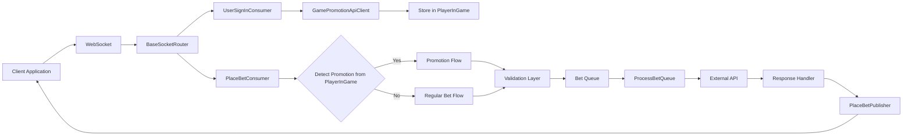
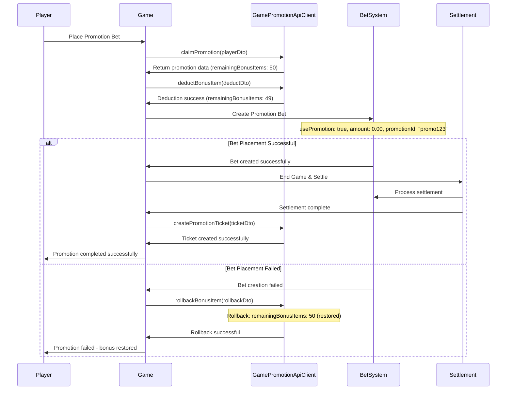
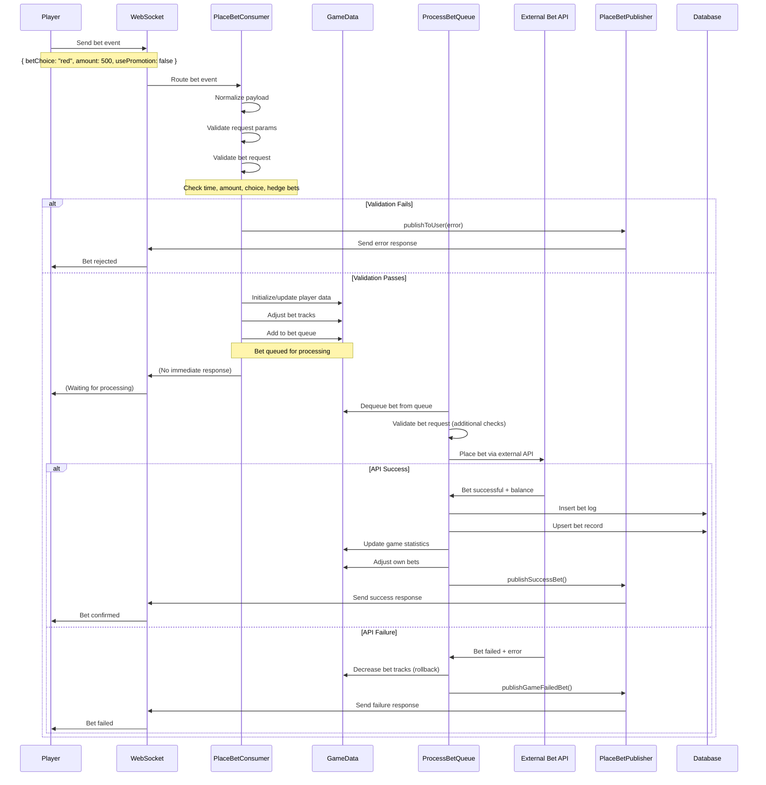
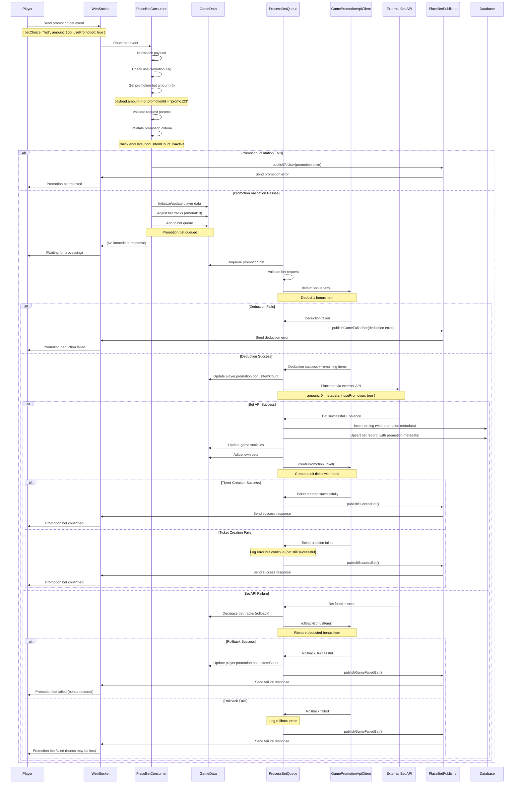
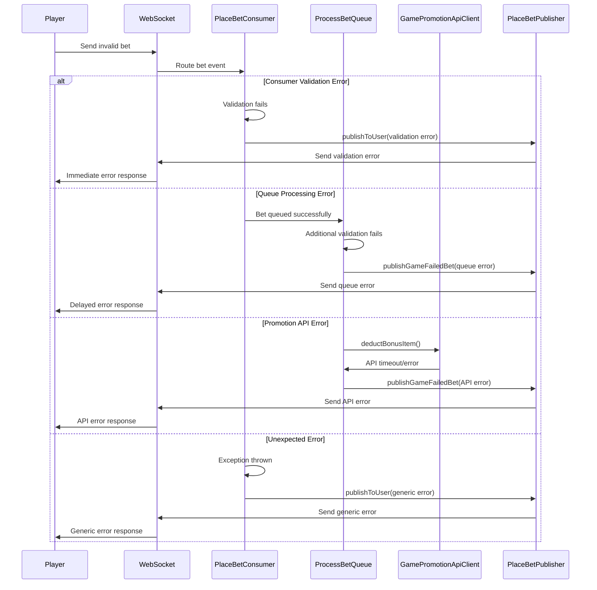
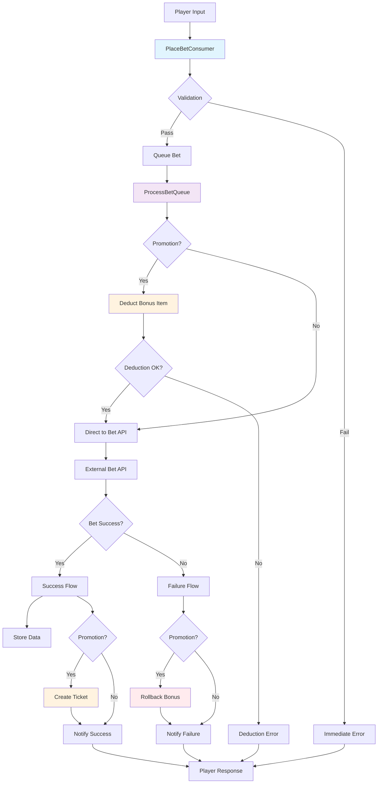

# Place Bet System - Flow Diagrams (Updated with Promotion)

## Overview

The place bet flow has been updated to include promotion functionality using Pentagon's official `@sc/game-promotion-api-client` package, broken down into smaller, focused diagrams for better readability and understanding.

## 1. High-Level Overview



## 2. User Sign-In & Promotion Claiming

```mermaid
flowchart TD
    SignInRequest[User Sign-In Request] --> UserSignInConsumer[UserSignInConsumer]
    UserSignInConsumer --> ValidateUser[Validate User Session]
    ValidateUser --> UserValid{User Valid?}

    UserValid -->|No| RejectSignIn[Reject Sign-In]
    UserValid -->|Yes| CallOfficialAPI[Call GamePromotionApiClient.claimPromotion()]

    CallOfficialAPI --> PromotionResult{Promotion Available?}
    PromotionResult -->|No| CreatePlayerData[Create PlayerInGame without Promotions]
    PromotionResult -->|Yes| StorePromotionData[Store Promotion Data in PlayerInGame]

    StorePromotionData --> SetPromotion[Set promotion Object]
    SetPromotion --> SetPromotionFields[promotionId, code, bonusItemCount]
    SetPromotionFields --> CompleteSignIn[Complete Sign-In Process]

    CreatePlayerData --> CompleteSignIn
    CompleteSignIn --> NotifyClient[Notify Client of Sign-In Success]

    classDef signInStyle fill:#f3e5f5,stroke:#4a148c
    classDef apiStyle fill:#e1f5fe,stroke:#0277bd
    classDef dataStyle fill:#e8f5e8,stroke:#1b5e20
    classDef errorStyle fill:#ffebee,stroke:#c62828

    class UserSignInConsumer,ValidateUser,CompleteSignIn signInStyle
    class CallOfficialAPI apiStyle
    class StorePromotionData,SetPromotion,SetPromotionFields,CreatePlayerData dataStyle
    class RejectSignIn errorStyle
```

## 3. Request Reception & Initial Processing (Updated)

```mermaid
flowchart TD
    Client[Client Application] -->|bet event| Socket[WebSocket Connection]
    Socket --> Router[BaseSocketRouter]
    Router --> Verify{verify connection?}
    Verify -->|No| Reject[Reject Request]
    Verify -->|Yes| Consumer[PlaceBetConsumer]
    Consumer --> Normalize[Normalize Payload]
    Normalize --> CheckPromotion{Promotion Bet?}

    CheckPromotion -->|Yes| GetPromotion[Get Promotion from PlayerInGame]
    CheckPromotion -->|No| ParamCheck[Parameter Validation]

    GetPromotion --> CheckBonusCount{bonusItemCount > 0?}
    CheckBonusCount -->|No| ParamCheck
    CheckBonusCount -->|Yes| DeductBonus[Call GamePromotionApiClient.deductBonusItem()]
    DeductBonus --> BonusSuccess{API Success?}
    BonusSuccess -->|No| BonusError[Send API Error]
    BonusSuccess -->|Yes| SetPromotionParams[Set Promotion Parameters with promotionId]
    SetPromotionParams --> ParamCheck

    ParamCheck -->|Invalid| ErrorResponse[Send Error Response]
    ParamCheck -->|Valid| BetValidation[Business Logic Validation]

    classDef errorStyle fill:#ffebee,stroke:#c62828
    classDef successStyle fill:#e8f5e8,stroke:#2e7d32
    classDef apiStyle fill:#e1f5fe,stroke:#0277bd

    class Reject,ErrorResponse,BonusError errorStyle
    class Consumer,Normalize,BetValidation successStyle
    class GetPromotion,DeductBonus,SetPromotionParams apiStyle
```

## 4. Promotion Detection & Validation Layer

```mermaid
flowchart TD
    PromotionDetection[Promotion Detection] --> CheckPlayerData[Check PlayerInGame Data]
    CheckPlayerData --> GetPromotion[Get Promotion from PlayerInGame]

    GetPromotion --> PromotionData[Return Promotion Data]
    PromotionData --> ShowData[promotionId, code, bonusItemCount]
    ShowData --> HasBonusItems{bonusItemCount > 0?}
    HasBonusItems -->|No| NoPromotions[No Promotions Available]
    HasBonusItems -->|Yes| DeductAPI[Call GamePromotionApiClient.deductBonusItem()]

    NoPromotions --> RegularBetFlow[Continue as Regular Bet]

    DeductAPI --> DeductResult{API Success?}
    DeductResult -->|No| APIError[API Error Response]
    DeductResult -->|Yes| UpdatePlayerData[Update PlayerInGame bonusItemCount]
    UpdatePlayerData --> RegularValidation[Continue to Regular Validation]

    classDef dataStyle fill:#e8f5e8,stroke:#1b5e20
    classDef apiStyle fill:#e1f5fe,stroke:#0277bd
    classDef promotionStyle fill:#fff3e0,stroke:#e65100
    classDef errorStyle fill:#ffebee,stroke:#c62828
    classDef successStyle fill:#e8f5e8,stroke:#2e7d32

    class CheckPlayerData,GetPromotion,UpdatePlayerData dataStyle
    class DeductAPI apiStyle
    class PromotionData,ShowData promotionStyle
    class APIError,NoPromotions errorStyle
    class RegularValidation,RegularBetFlow successStyle
```

## 5. Regular Validation Layer Details

```mermaid
flowchart TD
    BetValidation[Business Logic Validation] --> TimeCheck[Betting Time Validation]
    BetValidation --> AmountCheck[Bet Amount Validation]
    BetValidation --> ChoiceCheck[Bet Choice Validation]
    BetValidation --> HedgeCheck[Hedge Bet Validation]
    BetValidation --> PromotionCheck[Promotion Config Check]

    TimeCheck --> TimeResult{Valid?}
    AmountCheck --> AmountResult{Valid?}
    ChoiceCheck --> ChoiceResult{Valid?}
    HedgeCheck --> HedgeResult{Valid?}
    PromotionCheck --> PromotionResult{Valid?}

    TimeResult -->|No| ValidationFail[Validation Failed]
    AmountResult -->|No| ValidationFail
    ChoiceResult -->|No| ValidationFail
    HedgeResult -->|No| ValidationFail
    PromotionCheck -->|No| ValidationFail

    TimeResult -->|Yes| ValidationPass[All Validations Pass]
    AmountResult -->|Yes| ValidationPass
    ChoiceResult -->|Yes| ValidationPass
    HedgeResult -->|Yes| ValidationPass
    PromotionResult -->|Yes| ValidationPass

    ValidationFail --> CheckPromotion{Was Promotion?}
    CheckPromotion -->|Yes| RollbackAPI[Call GamePromotionApiClient.rollbackBonusItem()]
    CheckPromotion -->|No| NotifyError[Notify Error to Client]
    RollbackAPI --> NotifyError

    ValidationPass --> PlayerManagement[Player Data Management]

    classDef validationStyle fill:#fff3e0,stroke:#e65100
    classDef errorStyle fill:#ffebee,stroke:#c62828
    classDef successStyle fill:#e8f5e8,stroke:#2e7d32
    classDef apiStyle fill:#e1f5fe,stroke:#0277bd

    class TimeCheck,AmountCheck,ChoiceCheck,HedgeCheck,PromotionCheck validationStyle
    class ValidationFail,NotifyError errorStyle
    class ValidationPass,PlayerManagement successStyle
    class RollbackAPI apiStyle
```

## 6. Player Data Management (Updated)


## 7. Queue Processing (Updated)


## 8. API Processing & Response Handling (Updated)

```mermaid
flowchart TD
    APICall[External API Call] --> APIResponse{API Response}
    APIResponse -->|Success| SuccessPath[Success Handler]
    APIResponse -->|Failure| FailurePath[Failure Handler]

    SuccessPath --> InsertLog[Insert Bet Log]
    InsertLog --> UpsertBet[Upsert Bet Record]
    UpsertBet --> UpdateStats[Update Game Statistics]
    UpdateStats --> CheckBetType{Promotion Bet?}

    CheckBetType -->|Yes| CreateTicketAPI[Call GamePromotionApiClient.createPromotionTicket()]
    CheckBetType -->|No| CheckFreeBet{Free Bet?}

    CreateTicketAPI --> TicketResult{API Success?}
    TicketResult -->|Yes| NotifySuccess[Notify Success]
    TicketResult -->|No| LogTicketError[Log Ticket Creation Error]
    LogTicketError --> NotifySuccess

    CheckFreeBet -->|Yes| UpdateBalance[Update Balance & Coins]
    CheckFreeBet -->|No| NotifySuccess
    UpdateBalance --> NotifySuccess

    FailurePath --> CheckFailedBetType{Failed Promotion?}
    CheckFailedBetType -->|Yes| RollbackBonusAPI[Call GamePromotionApiClient.rollbackBonusItem()]
    CheckFailedBetType -->|No| RollbackTracks[Rollback Bet Tracks]

    RollbackBonusAPI --> NotifyFailure[Notify Failure]
    RollbackTracks --> NotifyFailure

    NotifySuccess --> Publisher[PlaceBetPublisher]
    NotifyFailure --> Publisher
    Publisher --> ClientResponse[Send to Client via WebSocket]

    classDef successStyle fill:#e8f5e8,stroke:#2e7d32
    classDef failureStyle fill:#ffebee,stroke:#c62828
    classDef publisherStyle fill:#e3f2fd,stroke:#0d47a1
    classDef apiStyle fill:#e1f5fe,stroke:#0277bd

    class SuccessPath,InsertLog,UpsertBet,UpdateStats,UpdateBalance,NotifySuccess successStyle
    class FailurePath,RollbackTracks,NotifyFailure,LogTicketError failureStyle
    class Publisher,ClientResponse publisherStyle
    class CreateTicketAPI,RollbackBonusAPI apiStyle
```

## 9. Promotion Sequence Flow (Official API)



## 10. Complete Bet Flow Sequence Diagrams

### 10.1 Regular Bet Flow Sequence



### 10.2 Promotion Bet Flow Sequence



### 10.3 Error Handling Flow Sequence



### 10.4 Data Flow Summary



## Summary

The updated place bet system now handles both regular bets and promotions using Pentagon's official `@sc/game-promotion-api-client` package with these key enhancements:

### **Official API Integration:**

1. **GamePromotionApiClient.claimPromotion()**: Check and claim promotions during sign-in
2. **GamePromotionApiClient.deductBonusItem()**: Deduct bonus items before bet placement
3. **GamePromotionApiClient.rollbackBonusItem()**: Rollback bonus items if bet fails
4. **GamePromotionApiClient.createPromotionTicket()**: Create audit tickets with betId and promotionId
5. **Zero-amount handling**: Process bets with 0.00 amount
6. **Promotion tracking**: Include promotionId in bet data throughout the entire flow
7. **Official state management**: All promotion state managed via Pentagon's official APIs

### **Enhanced Error Handling:**

- Promotion specific error paths with official API fallbacks
- Dedicated rollback mechanisms through official API
- Promotion state consistency via Pentagon's infrastructure

### **Validation Layers:**

1. Promotion eligibility validation via official API
2. Bonus items availability check through API response
3. Regular bet validation (adapted for promotions)
4. Official API-level validation and error handling

### **Data Flow:**

- Maintains separation between promotion and regular bet logic
- Official API-based communication for all promotion operations
- Consistent error handling across both flows
- Comprehensive audit trail via official promotion ticket API

This official API-based approach ensures that promotion functionality integrates seamlessly with the existing place bet system while maintaining clear separation of concerns, official Pentagon support, and robust error handling through Pentagon's standardized promotion infrastructure.

```

```
