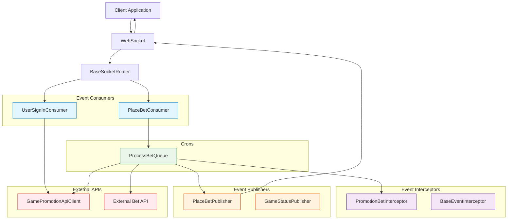
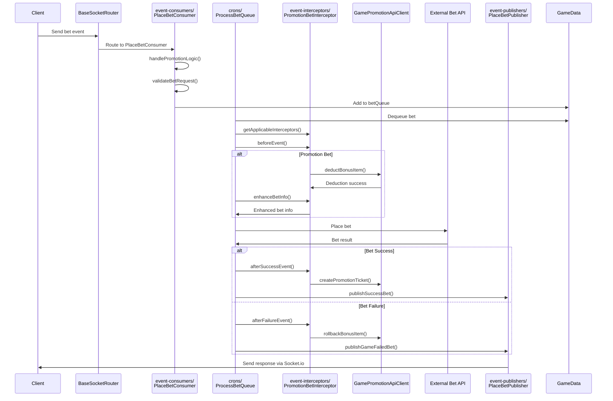

# Place Bet System - Flow Diagrams (Updated with SC-Game-Base Architecture)

## Overview

The place bet flow follows the sc-game-base architecture with proper separation of concerns into event-consumers, event-interceptors, and crons. The system uses Pentagon's official `@sc/game-promotion-api-client` package for promotion functionality.

## 1. High-Level Architecture Overview



## 2. Event-Consumers: User Sign-In & Promotion Claiming

```mermaid
flowchart TD
    SignInRequest[User Sign-In Request] --> Router[BaseSocketRouter]
    Router --> UserSignInConsumer[src/core/event-consumers/<br/>UserSignInConsumer]

    UserSignInConsumer --> ValidateUser[Validate User Session]
    ValidateUser --> UserValid{User Valid?}

    UserValid -->|No| RejectSignIn[Reject Sign-In]
    UserValid -->|Yes| CallOfficialAPI[Call GamePromotionApiClient.claimPromotion()]

    CallOfficialAPI --> PromotionResult{Promotion Available?}
    PromotionResult -->|No| CreatePlayerData[Create PlayerInGame without Promotions]
    PromotionResult -->|Yes| StorePromotionData[Store Promotion Data in PlayerInGame]

    StorePromotionData --> SetPromotion[Set promotion Object]
    SetPromotion --> SetPromotionFields[promotionId, code, bonusItemCount]
    SetPromotionFields --> CompleteSignIn[Complete Sign-In Process]

    CreatePlayerData --> CompleteSignIn
    CompleteSignIn --> Publisher[UserSignInPublisher]
    Publisher --> NotifyClient[Notify Client of Sign-In Success]

    classDef consumerStyle fill:#e1f5fe,stroke:#0277bd
    classDef apiStyle fill:#ffebee,stroke:#c62828
    classDef dataStyle fill:#e8f5e8,stroke:#1b5e20
    classDef publisherStyle fill:#fff3e0,stroke:#e65100
    classDef errorStyle fill:#ffebee,stroke:#c62828

    class UserSignInConsumer consumerStyle
    class CallOfficialAPI apiStyle
    class StorePromotionData,SetPromotion,SetPromotionFields,CreatePlayerData dataStyle
    class Publisher publisherStyle
    class RejectSignIn errorStyle
```

## 3. Event-Consumers: Request Reception & Initial Processing

```mermaid
flowchart TD
    Client[Client Application] -->|bet event| Socket[WebSocket Connection]
    Socket --> Router[BaseSocketRouter]
    Router --> Verify{verify connection?}
    Verify -->|No| Reject[Reject Request]
    Verify -->|Yes| PlaceBetConsumer[src/core/event-consumers/<br/>PlaceBetConsumer]

    PlaceBetConsumer --> Normalize[Normalize Payload]
    Normalize --> HandlePromotion[handlePromotionLogic()]
    HandlePromotion --> GetPromotionAmount[getPromotionBetAmount()]
    GetPromotionAmount --> ParamCheck[Parameter Validation]

    ParamCheck -->|Invalid| ErrorResponse[Send Error Response]
    ParamCheck -->|Valid| BetValidation[Business Logic Validation]
    BetValidation --> PromotionValidation[composePromotionValidationCriteria()]

    PromotionValidation -->|Invalid| ValidationError[Validation Error]
    PromotionValidation -->|Valid| InitializePlayer[initializePlayerData()]
    InitializePlayer --> AdjustTracks[adjustBetTracks()]
    AdjustTracks --> QueueBet[Add to betQueue]

    classDef consumerStyle fill:#e1f5fe,stroke:#0277bd
    classDef errorStyle fill:#ffebee,stroke:#c62828
    classDef successStyle fill:#e8f5e8,stroke:#2e7d32
    classDef promotionStyle fill:#fff3e0,stroke:#e65100

    class PlaceBetConsumer consumerStyle
    class Reject,ErrorResponse,ValidationError errorStyle
    class Normalize,BetValidation,InitializePlayer,AdjustTracks,QueueBet successStyle
    class HandlePromotion,GetPromotionAmount,PromotionValidation promotionStyle
```

## 4. Event-Interceptors: Promotion Processing

```mermaid
flowchart TD
    InterceptorStart[Interceptor System Start] --> GetApplicable[getApplicableInterceptors()]
    GetApplicable --> CheckPromotion{Promotion Bet?}

    CheckPromotion -->|No| RegularFlow[Regular Bet Flow]
    CheckPromotion -->|Yes| PromotionBetInterceptor[src/core/event-interceptors/<br/>PromotionBetInterceptor]

    PromotionBetInterceptor --> BeforeEvent[beforeEvent()]
    BeforeEvent --> ValidatePromotion[Validate Promotion Eligibility]
    ValidatePromotion --> TransformBet[enhanceBetInfo()]
    TransformBet --> SetPromotionMeta[Set Promotion Metadata]
    SetPromotionMeta --> AfterSuccess[afterSuccessEvent()]

    AfterSuccess --> CreateTicket[createPromotionTicket()]
    CreateTicket --> AfterFailure[afterFailureEvent() - on error]
    AfterFailure --> RollbackBonus[rollbackBonusItem()]

    RegularFlow --> ContinueProcessing[Continue to ProcessBetQueue]
    RollbackBonus --> ContinueProcessing
    CreateTicket --> ContinueProcessing

    classDef interceptorStyle fill:#f3e5f5,stroke:#4a148c
    classDef promotionStyle fill:#fff3e0,stroke:#e65100
    classDef apiStyle fill:#ffebee,stroke:#c62828
    classDef successStyle fill:#e8f5e8,stroke:#2e7d32

    class PromotionBetInterceptor,BeforeEvent,TransformBet,AfterSuccess,AfterFailure interceptorStyle
    class ValidatePromotion,SetPromotionMeta promotionStyle
    class CreateTicket,RollbackBonus apiStyle
    class RegularFlow,ContinueProcessing successStyle
```

## 5. Crons: Queue Processing with Interceptors

```mermaid
flowchart TD
    QueueProcessor[src/core/crons/<br/>ProcessBetQueue] --> CheckQueues[Check All Player Queues]
    CheckQueues --> HasBets{Queue Has Bets?}
    HasBets -->|No| WaitLoop[Wait 50ms]
    WaitLoop --> CheckQueues

    HasBets -->|Yes| CheckProcessing{Player Processing?}
    CheckProcessing -->|Yes| WaitLoop
    CheckProcessing -->|No| DequeueBet[Dequeue Next Bet]

    DequeueBet --> SetProcessing[Set Player Processing = true]
    SetProcessing --> GetInterceptors[getApplicableInterceptors()]
    GetInterceptors --> BeforeEvent[Execute beforeEvent Interceptors]
    BeforeEvent --> ValidateBet[validateBetRequest()]

    ValidateBet -->|Invalid| FailureFlow[Handle Failed Bet]
    ValidateBet -->|Valid| EnhanceBetInfo[enhanceBetInfo() Transform]
    EnhanceBetInfo --> APICall[Call External Bet API]

    APICall --> APIResponse{API Success?}
    APIResponse -->|Yes| SuccessFlow[handleSuccessBet()]
    APIResponse -->|No| FailureFlow

    SuccessFlow --> AfterSuccess[Execute afterSuccessEvent]
    FailureFlow --> AfterFailure[Execute afterFailureEvent]
    AfterSuccess --> ProcessComplete[Set Processing = false]
    AfterFailure --> ProcessComplete

    classDef cronStyle fill:#e8f5e8,stroke:#1b5e20
    classDef interceptorStyle fill:#f3e5f5,stroke:#4a148c
    classDef processStyle fill:#e3f2fd,stroke:#0d47a1
    classDef apiStyle fill:#ffebee,stroke:#c62828

    class QueueProcessor cronStyle
    class GetInterceptors,BeforeEvent,EnhanceBetInfo,AfterSuccess,AfterFailure interceptorStyle
    class SetProcessing,ValidateBet,SuccessFlow,FailureFlow,ProcessComplete processStyle
    class APICall apiStyle
```

## 6. Event-Publishers: Response Broadcasting

```mermaid
flowchart TD
    ResponseHandler[Response Handler] --> CheckResult{Success or Failure?}

    CheckResult -->|Success| PlaceBetPublisher[src/core/event-publishers/<br/>PlaceBetPublisher]
    CheckResult -->|Failure| PlaceBetPublisher

    PlaceBetPublisher --> PublishSuccess[publishSuccessBet()]
    PlaceBetPublisher --> PublishFailure[publishGameFailedBet()]

    PublishSuccess --> StatusPublisher[GameStatusPublisher]
    PublishFailure --> StatusPublisher

    StatusPublisher --> SocketBroadcast[Socket.io Broadcast]
    SocketBroadcast --> ClientResponse[Client Response]

    subgraph "Response Types"
        SuccessResp[Success: balance, betResult, ownBets]
        FailureResp[Failure: error, rollback notification]
        PromotionResp[Promotion: ticket created, bonus updated]
    end

    ClientResponse --> SuccessResp
    ClientResponse --> FailureResp
    ClientResponse --> PromotionResp

    classDef publisherStyle fill:#fff3e0,stroke:#e65100
    classDef responseStyle fill:#e3f2fd,stroke:#0d47a1
    classDef successStyle fill:#e8f5e8,stroke:#2e7d32
    classDef errorStyle fill:#ffebee,stroke:#c62828
    classDef promotionStyle fill:#f3e5f5,stroke:#4a148c

    class PlaceBetPublisher,StatusPublisher publisherStyle
    class SocketBroadcast,ClientResponse responseStyle
    class PublishSuccess,SuccessResp successStyle
    class PublishFailure,FailureResp errorStyle
    class PromotionResp promotionStyle
```

## 7. Complete Architecture Flow Sequence



## 8. Folder Structure Summary

```
src/core/
├── event-consumers/
│   ├── place-bet-consumer.js          # Main bet processing logic
│   ├── user-sign-in-consumer.js       # Promotion claiming
│   └── ...
├── event-interceptors/
│   ├── base-event-interceptor.js      # Base interceptor class
│   ├── promotion-bet-interceptor.js   # Promotion-specific logic
│   └── index.js                       # Interceptor exports
├── crons/
│   ├── process-bet-queue.js           # Queue processing with interceptors
│   └── ...
├── event-publishers/
│   ├── place-bet-publisher.js         # Response broadcasting
│   ├── game-status-publisher.js       # Game state updates
│   └── ...
└── mixins/
    └── event-interceptor-mixin.js     # Interceptor functionality
```

## Key Architecture Benefits

### **Separation of Concerns**

- **event-consumers**: Handle request validation and queuing
- **event-interceptors**: Manage cross-cutting concerns (promotions, analytics)
- **crons**: Process queued operations with interceptor integration
- **event-publishers**: Broadcast responses to clients

### **Interceptor Pattern**

- Modular and pluggable promotion logic
- Easy to add new interceptors for different features
- Clean separation from core betting logic
- Reusable across different game types

### **Official API Integration**

- Pentagon's `@sc/game-promotion-api-client` for all promotion operations
- Consistent promotion state management
- Built-in error handling and rollback mechanisms
- Standardized audit trail via promotion tickets

This architecture ensures maintainable, scalable, and testable code that follows sc-game-base patterns while providing robust promotion functionality through Pentagon's official APIs.

```

```
