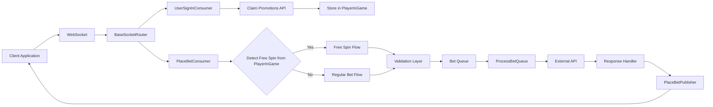
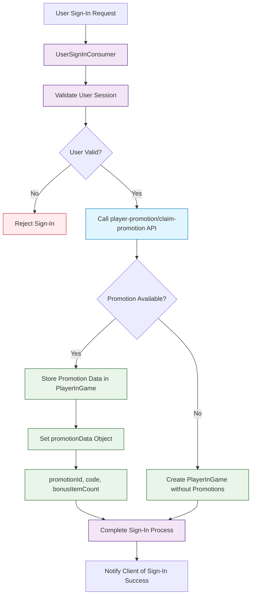
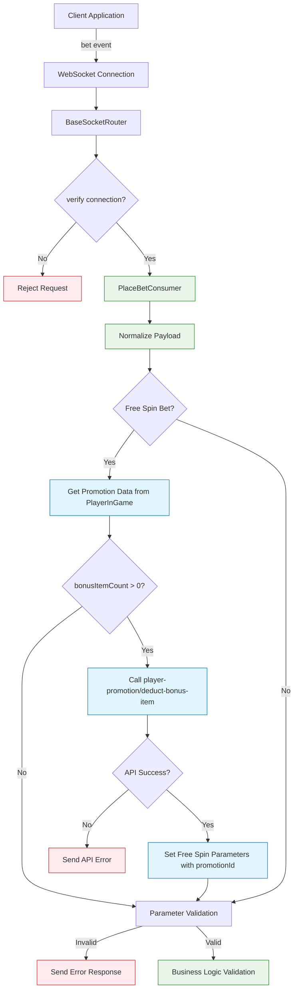
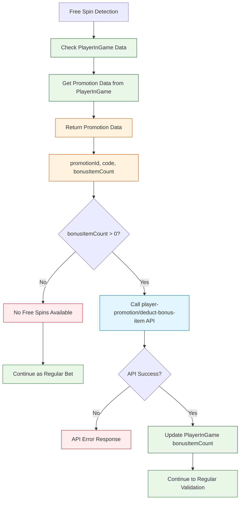
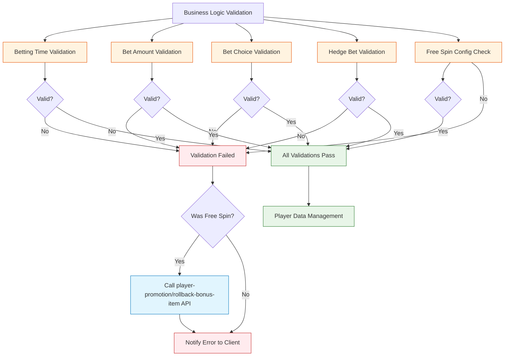
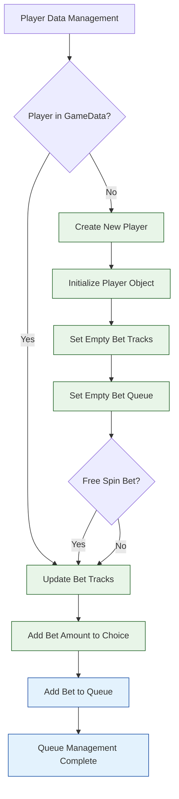
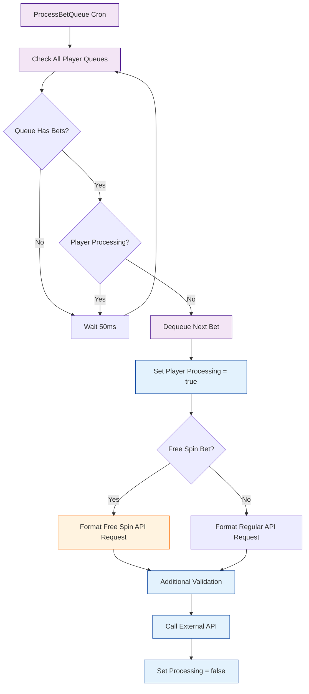
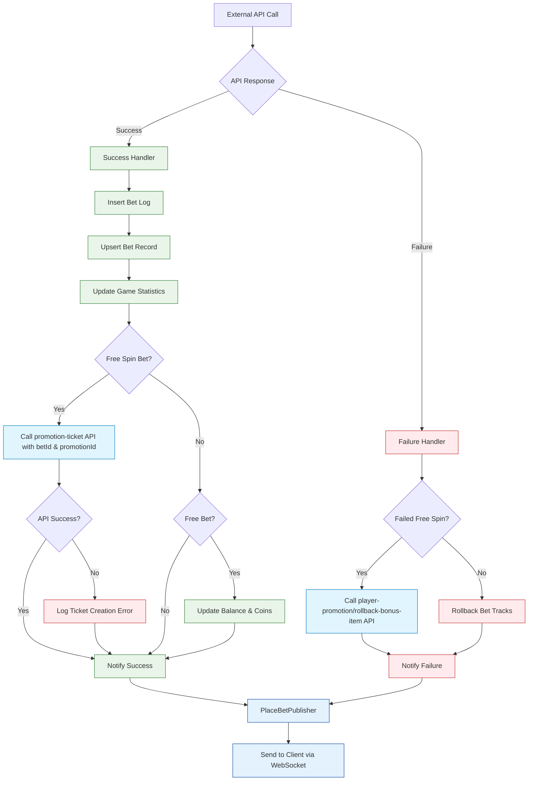
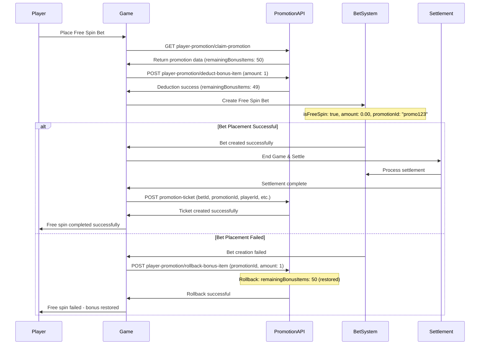

# Place Bet System - Flow Diagrams (Updated with Free Spin)

## Overview

The place bet flow has been updated to include free spin functionality, broken down into smaller, focused diagrams for better readability and understanding.

## 1. High-Level Overview



## 2. User Sign-In & Promotion Claiming



## 3. Request Reception & Initial Processing (Updated)



## 4. Free Spin Detection & Validation Layer



## 5. Regular Validation Layer Details



## 6. Player Data Management (Updated)



## 6. Queue Processing (Updated)



## 8. API Processing & Response Handling (Updated)



## 9. Free Spin Sequence Flow (API-Based)



## Summary

The updated place bet system now handles both regular bets and free spins with these key enhancements:

### **Free Spin Specific Features (API-Based):**

1. **API-based validation**: Call `player-promotion/claim-promotion` to check eligibility
2. **API-based deduction**: Call `player-promotion/deduct-bonus-item` before bet placement
3. **API-based rollback**: Call `player-promotion/rollback-bonus-item` if bet fails
4. **API-based tracking**: Call `promotion-ticket` API with betId and promotionId for complete audit trail
5. **Zero-amount handling**: Process bets with 0.00 amount
6. **Promotion tracking**: Include promotionId in bet data throughout the entire flow
7. **External state management**: All promotion state managed via Promotion APIs

### **Enhanced Error Handling:**

- Free spin specific error paths with API fallbacks
- Dedicated `rollback-bonus-item` API for bonus item restoration on failures
- Promotion state consistency via external APIs

### **Validation Layers:**

1. Free spin eligibility validation via `player-promotion/claim-promotion` API
2. Bonus items availability check through API response
3. Regular bet validation (adapted for free spins)
4. API-level validation and error handling

### **Data Flow:**

- Maintains separation between free spin and regular bet logic
- API-based communication for all promotion operations
- Consistent error handling across both flows
- Comprehensive audit trail via `promotion-ticket` API

This API-based approach ensures that free spin functionality integrates seamlessly with the existing place bet system while maintaining clear separation of concerns, external state management, and robust error handling through dedicated Promotion APIs.

```

```
