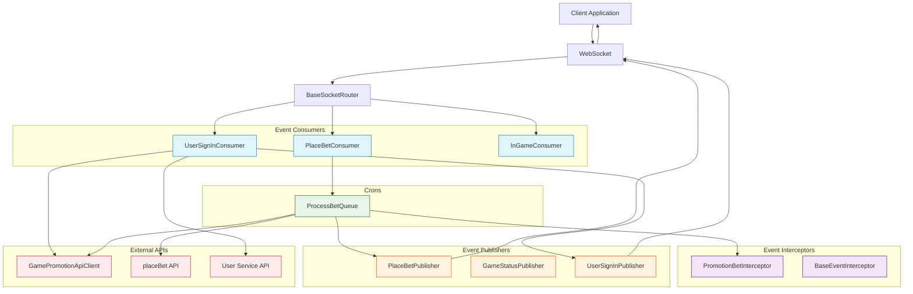
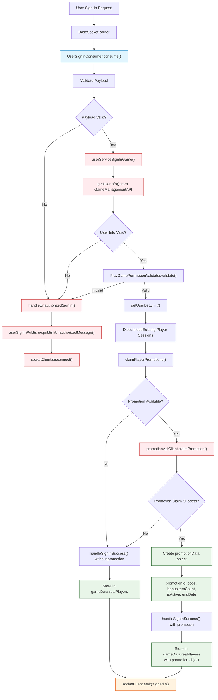
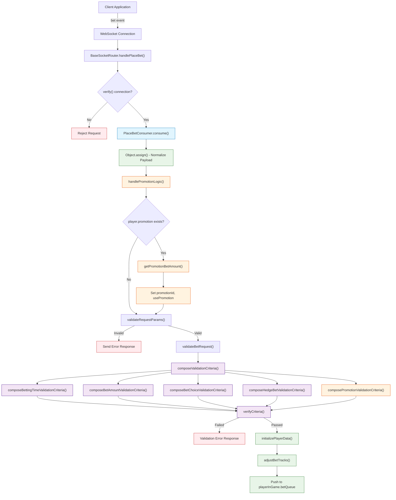
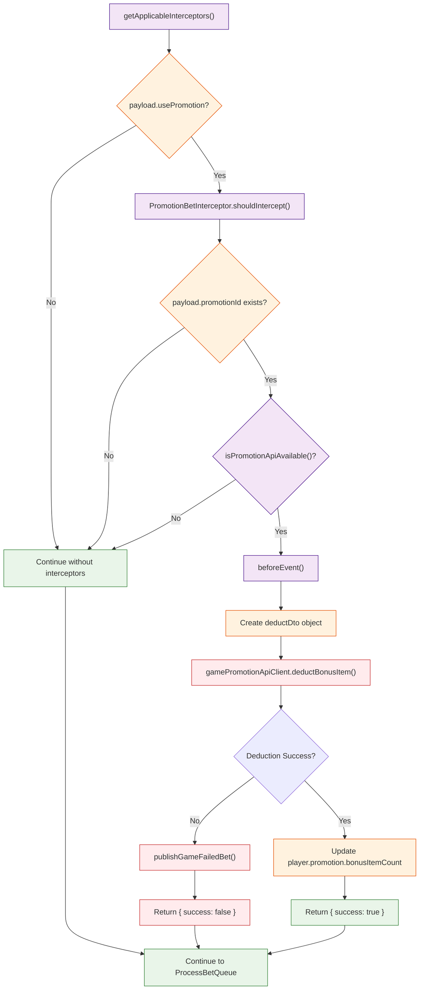
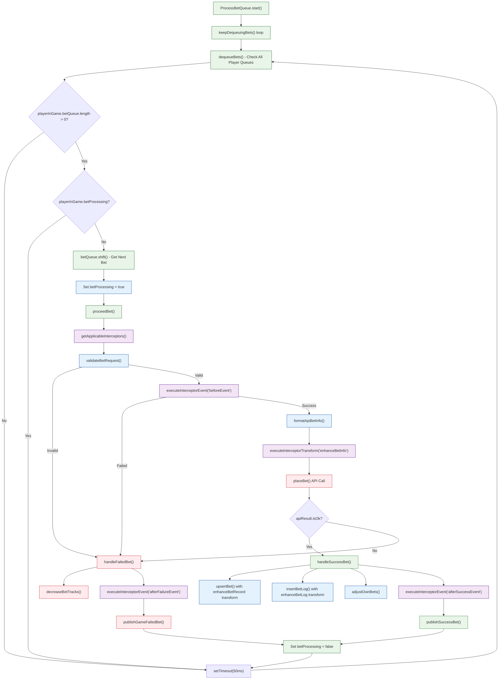
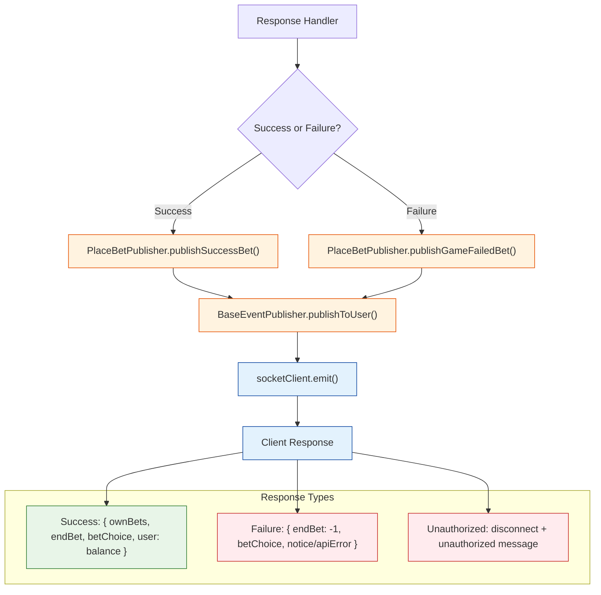
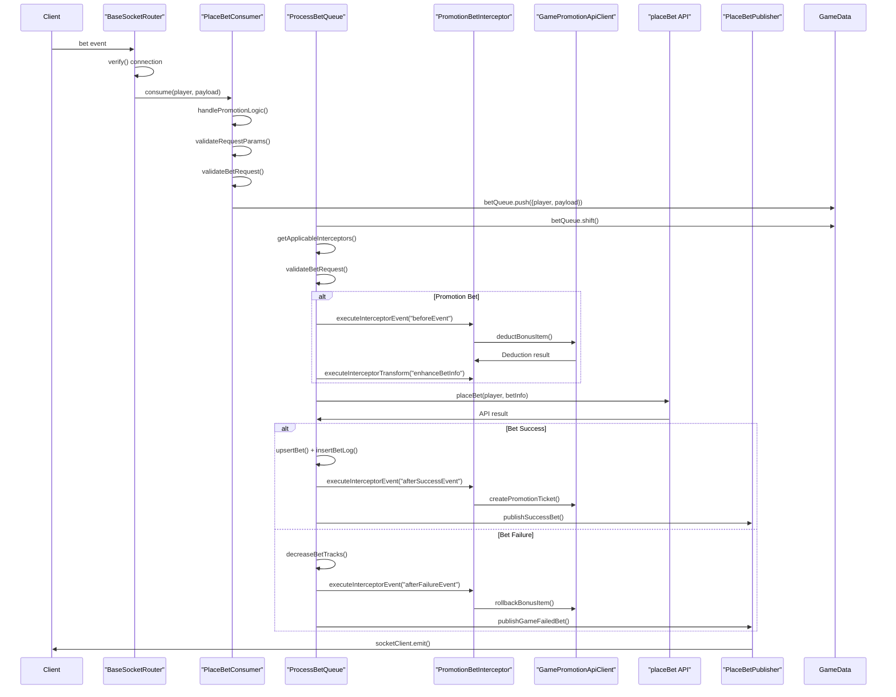

# Place Bet System - Flow Diagrams (Updated with Current Codebase Implementation)

## Overview

The place bet flow follows the sc-game-base architecture with proper separation of concerns into event-consumers, event-interceptors, and crons. The system uses Pentagon's official `@sc/game-promotion-api-client` package for promotion functionality.

## 1. High-Level Architecture Overview



## 2. Event-Consumers: User Sign-In & Promotion Claiming



## 3. Event-Consumers: Place Bet Request Processing



## 4. Event-Interceptors: Promotion Processing



## 5. Crons: Queue Processing with Interceptors



## 6. Event-Publishers: Response Broadcasting



## 7. Complete Architecture Flow Sequence



## 8. Folder Structure Summary

```
src/core/
├── event-consumers/
│   ├── place-bet-consumer.js          # Main bet processing logic
│   ├── user-signin-consumer.js        # User authentication & promotion claiming
│   ├── in-game-consumer.js            # In-game state management
│   └── index.js                       # Consumer exports
├── event-interceptors/
│   ├── base-event-interceptor.js      # Base interceptor class
│   ├── promotion-bet-interceptor.js   # Promotion-specific logic
│   └── index.js                       # Interceptor exports
├── crons/
│   ├── process-bet-queue.js           # Queue processing with interceptors
│   └── index.js                       # Cron exports
├── event-publishers/
│   ├── place-bet-publisher.js         # Bet result broadcasting
│   ├── user-signin-publisher.js       # Sign-in responses
│   ├── base-event-publisher.js        # Base publisher functionality
│   └── index.js                       # Publisher exports
├── routers/
│   ├── base-socket-router.js          # WebSocket event routing
│   └── index.js                       # Router exports
└── mixins/
    └── event-interceptor-mixin.js     # Interceptor functionality
```

## Key Architecture Benefits

### **Separation of Concerns**

- **event-consumers**: Handle request validation and queuing
- **event-interceptors**: Manage cross-cutting concerns (promotions, analytics)
- **crons**: Process queued operations with interceptor integration
- **event-publishers**: Broadcast responses to clients
- **routers**: Route WebSocket events to appropriate consumers

### **Interceptor Pattern**

- Modular and pluggable promotion logic
- Easy to add new interceptors for different features
- Clean separation from core betting logic
- Reusable across different game types

### **Official API Integration**

- Pentagon's `@sc/game-promotion-api-client` for all promotion operations
- Consistent promotion state management
- Built-in error handling and rollback mechanisms
- Standardized audit trail via promotion tickets

### **Current Implementation Features**

- **Robust Validation**: Multiple validation layers in both consumer and cron
- **Error Handling**: Comprehensive error handling with proper rollback
- **Performance**: 50ms processing timeout for optimal throughput
- **Scalability**: Queue-based processing prevents blocking
- **Monitoring**: Built-in metrics and logging throughout the flow

This architecture ensures maintainable, scalable, and testable code that follows sc-game-base patterns while providing robust promotion functionality through Pentagon's official APIs.

```

```
