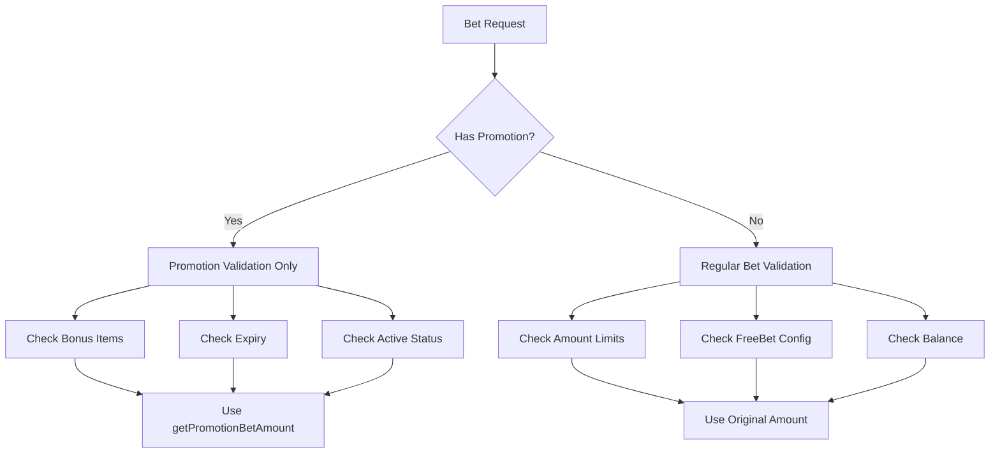

# Promotion Bet Validation Guide

## Overview

Promotion bets use a completely different validation flow from regular bets. This document explains the correct validation behavior after the fixes in version 6.0.0.

## Key Principles

### 1. **Complete Amount Validation Bypass**

Promotion bets skip ALL amount-related validation:

- ❌ No min bet validation
- ❌ No max bet validation
- ❌ No max bet per choice validation
- ❌ No freeBet configuration validation
- ❌ No balance checks (handled by promotion system)

### 2. **Amount Override Pattern**

```javascript
// Client sends any amount
const clientPayload = {
  amount: 999999, // Can be ANY value
  betChoice: "red",
  usePromotion: true,
};

// Server processes with predetermined amount
const processedPayload = {
  amount: 5, // Overridden by getPromotionBetAmount()
  betChoice: "red",
  promotionId: "promo123",
  usePromotion: true,
};
```

### 3. **Separate Validation Systems**



## Implementation Details

### Validation Method Changes

#### Before (Incorrect)

```javascript
// WRONG - Mixed validation systems
if (player.promotion) {
  return [
    {
      failure: freeBet && !configs.enableFreeBet, // ❌ Wrong validation
      notice: this.getNoticeObj(helpers.noticeHelper.invalidBet),
    },
  ];
}
```

#### After (Correct)

```javascript
// CORRECT - Complete bypass
if (player.promotion) {
  return []; // No amount validation needed for promotion bets
}
```

### Validation Flow

1. **Request Parameters** - Basic validation (betChoice exists, clientSeed valid)
2. **Betting Time** - Game timing validation (same for all bet types)
3. **Bet Choice** - Valid choice validation (same for all bet types)
4. **Amount Validation** - **SKIPPED** for promotion bets
5. **Hedge Bet** - Anti-hedging validation (same for all bet types)
6. **Promotion Validation** - **ONLY** for promotion bets

### Promotion-Specific Validation

```javascript
composePromotionValidationCriteria(player) {
    if (!player.promotion) {
        return [];
    }

    return [
        {
            failure: !promotion.promotionId,
            notice: { msg: "No active promotion" }
        },
        {
            failure: promotion.bonusItemCount <= 0,
            notice: { msg: "No promotions available" }
        },
        {
            failure: promotion.endDate && new Date(promotion.endDate) < currentTime,
            notice: { msg: "Promotion has expired" }
        },
        {
            failure: promotion.isActive === false,
            notice: { msg: "Promotion is not active" }
        }
    ];
}
```

## Testing Guidelines

### Valid Promotion Bet Tests

```javascript
// All of these should succeed for promotion bets
const validPromotionTests = [
  { amount: -100 }, // Negative amount
  { amount: 0 }, // Zero amount
  { amount: 999999999 }, // Extremely high amount
  { freeBet: true }, // FreeBet enabled
  { freeBet: false }, // FreeBet disabled
];

// With player having valid promotion:
// - bonusItemCount > 0
// - isActive = true
// - endDate in future (or null)
// - promotionId exists
```

### Invalid Promotion Bet Tests

```javascript
// These should fail promotion validation
const invalidPromotionTests = [
  { promotion: { bonusItemCount: 0 } }, // No bonus items
  { promotion: { isActive: false } }, // Inactive promotion
  { promotion: { endDate: "2020-01-01" } }, // Expired promotion
  { promotion: { promotionId: null } }, // No promotion ID
];
```

### Regular Bet Tests (No Promotion)

```javascript
// These should fail regular validation
const invalidRegularTests = [
  { amount: -100, freeBet: false }, // Negative amount
  { amount: 0, freeBet: false }, // Zero amount
  { amount: 999999, freeBet: false }, // Above max bet
  { amount: 100, freeBet: true, enableFreeBet: false }, // FreeBet disabled
];
```

## Migration Notes

### Code Changes Required

1. **Remove freeBet validation** from promotion bet paths
2. **Update test expectations** to reflect bypassed validation
3. **Update documentation** to clarify separate validation systems
4. **Verify promotion-specific validation** is working correctly

### Breaking Changes

- Tests that expected freeBet validation for promotion bets will fail
- Code that relied on amount validation for promotion bets will behave differently
- Any custom validation logic mixing promotion and regular bet validation needs review

## Common Mistakes

### ❌ Wrong: Mixed Validation Systems

```javascript
// Don't do this - mixing validation concerns
if (player.promotion && amount === promotionAmount) {
  // Validate freeBet settings for promotion
}
```

### ✅ Correct: Separate Validation Systems

```javascript
// Do this - separate concerns
if (player.promotion) {
  // Skip all amount validation
  return [];
}

// Regular validation for non-promotion bets
if (freeBet && !configs.enableFreeBet) {
  // Only validate freeBet for regular bets
}
```

### ❌ Wrong: Conditional Amount Override

```javascript
// Don't do this - conditional behavior
if (player.promotion && someCondition) {
  amount = getPromotionBetAmount();
}
```

### ✅ Correct: Always Override for Promotions

```javascript
// Do this - consistent behavior
if (player.promotion) {
  Object.assign(payload, {
    amount: this.getPromotionBetAmount(player, payload),
    promotionId: player.promotion.promotionId,
    usePromotion: true,
  });
}
```

## Debugging Tips

1. **Check promotion detection**: Verify `player.promotion` exists and is not null
2. **Verify amount override**: Confirm `getPromotionBetAmount()` is called and returns expected value
3. **Test validation bypass**: Ensure no amount validation criteria are returned for promotion bets
4. **Validate promotion criteria**: Check promotion-specific validation works correctly
5. **Test edge cases**: Verify behavior with invalid amounts, freeBet settings, etc.

---

_This document reflects the corrected behavior in SC-Game-Base 6.0.0+_
